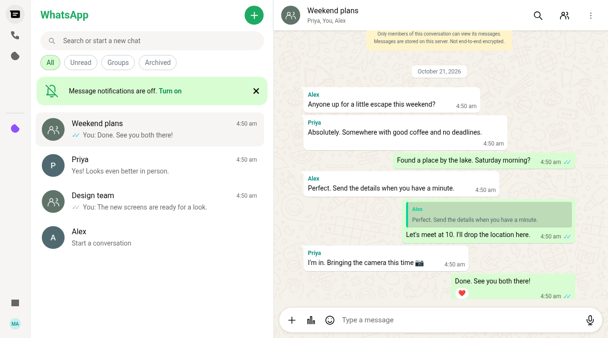
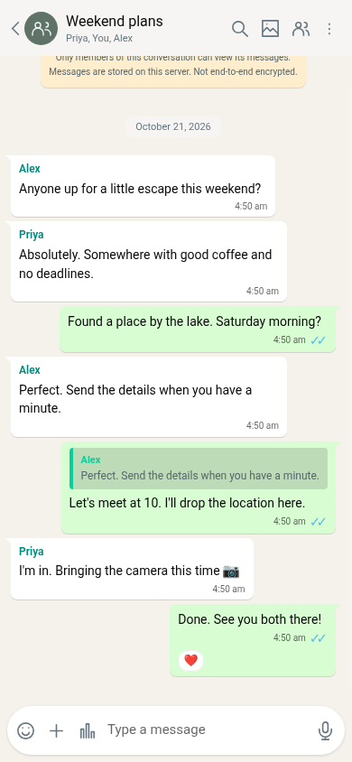
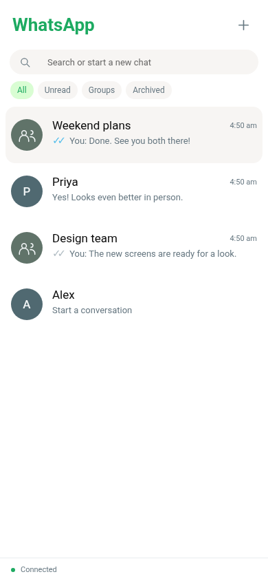
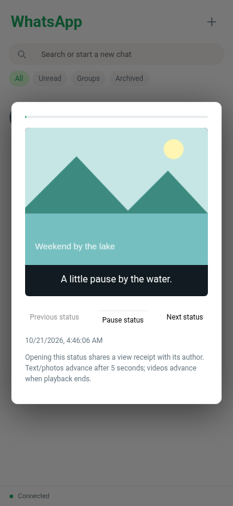
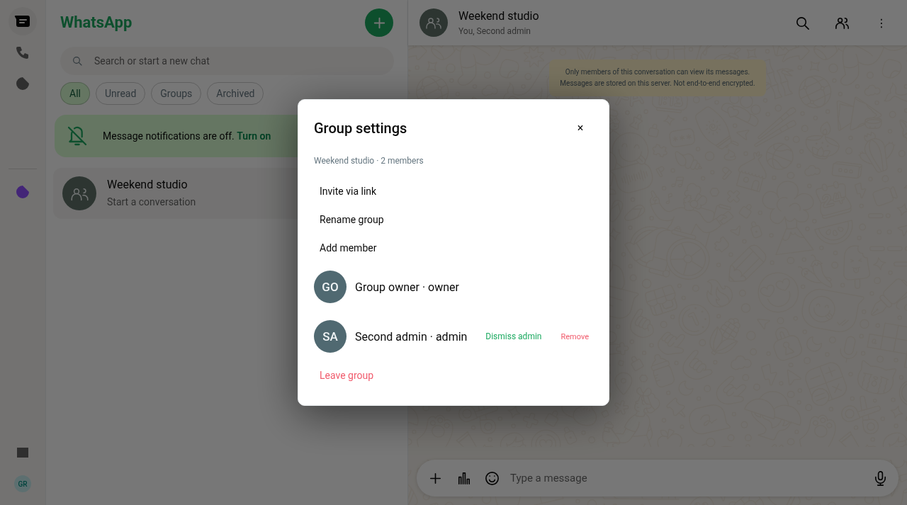

<div align="center">

# Real-Time Chat

### Familiar conversations. Built from the ground up.

A WhatsApp-style messaging app with real accounts, persistent chats, voice notes and a responsive light/dark interface.

**Node.js 22+** · **Express** · **Socket.IO** · **SQLite** · **Vanilla JavaScript**

[Get started](#get-started) · [Features](#features) · [Screenshots](#screenshots) · [Tests](#tests) · [Architecture](#architecture) · [Project status](#project-status)

</div>



> Independent project. Not affiliated with WhatsApp or Meta. This app does not connect to WhatsApp and does not provide end-to-end encryption.

## Get started

**Requirements:** Node.js 22.13 or later and npm. No API keys or external database needed.

```bash
git clone https://github.com/mananbharti/Real-Time-Chat-website-like-Whatsapp.git
cd Real-Time-Chat-website-like-Whatsapp
npm ci
npm start
```

Open **http://localhost:3000**. Create an account, then use **New chat** to talk to another registered account or create a group.

To try both sides of a conversation, open a second browser profile or an incognito window. Ordinary tabs share the same login.

## Features

| Conversations              | Messages                             | The details                      |
| -------------------------- | ------------------------------------ | -------------------------------- |
| Direct and group chats     | Text, photos, audio, video and PDFs  | Dark and light themes            |
| Persistent SQLite history  | Record, preview and send voice notes | Responsive mobile navigation     |
| Delivery and read receipts | Quote replies, forwarding and stars  | Per-chat drafts across reloads   |
| Online and last seen       | Delete for yourself or everyone      | Pin, mute and archive            |
| Typing and unread counts   | Emoji and safe clickable links       | Right-click and touch menus      |
| Group polls with live votes | App lock with the account password   | Unicode 17 emoji catalog         |
| Full-history search        | Shared-media gallery                 | Profile pictures and about lines |
| Membership-checked access  | Idempotent message retries           | Text/photo/video statuses (24h)  |

The emoji picker includes the complete pinned Unicode 17 catalog: 3,953 local Noto glyphs with categories, keyword search and skin variants. Noto artwork is not WhatsApp artwork.

Messages also support emoji reactions and sender edits within 15 minutes. Group admins can rename groups, add/remove members and promote/demote other admins. The owner stays protected and ownership passes to a remaining admin (or member) when they leave. Invite links expire after 7 days and can be reset or turned off; new members are warned that joining grants access to prior history. Removed members immediately lose access.

**The ticks are real.** One tick means the server stored a message. Gray double ticks mean every other member's client acknowledged delivery. Blue double ticks mean every other member acknowledged reading. Message info shows the recorded delivery/read times.

**The recorder is real.** Voice notes use the browser microphone, show a live waveform, can be previewed before sending, and play on the receiving client. Microphone access requires HTTPS or localhost.

## Screenshots

These captures are from the running app with local test accounts, not static mockups or real private conversations.

<table>
<tr>
<td align="center"><strong>Conversation</strong></td>
<td align="center"><strong>Chat list</strong></td>
</tr>
<tr>
<td></td>
<td></td>
</tr>
<tr>
<td align="center"><strong>Photo and video statuses</strong></td>
<td align="center"><strong>Group administration</strong></td>
</tr>
<tr>
<td></td>
<td></td>
</tr>
</table>

## Architecture

```text
Browser UI                  Express + Socket.IO                Local storage
──────────                  ───────────────────                ─────────────
HTML / CSS / JavaScript  ↔  Authenticated HTTP + sockets  ↔  SQLite accounts & messages
MediaRecorder + audio       Chat membership checks           Protected upload files
Local per-chat drafts       Validation + basic rate limits   Persistent sessions
```

```text
public/                Client interface, styles and behavior
server.js              HTTP API, socket events, authentication and database
 tests/
  server.test.js       API, persistence, authorization and upload checks
  browser/chat.spec.js Real multi-client browser flows
docs/                  Screenshots and technical notes
data/                  Database and uploads (created locally, ignored by Git)
```

The app uses one Node process and no paid services. Database and uploaded files are kept in `data/`; back up that directory to preserve them. Passwords use salted scrypt hashes. Sessions use HttpOnly/SameSite cookies and are revoked on logout.

## Tests

```bash
npm test                         # Integration tests
npx playwright install chromium # One-time browser installation
npm run test:e2e                  # Browser tests
npm run test:all                  # Both suites
```

The tests use isolated temporary databases. The suite has 20 integration tests and 15 browser scenarios. Browser checks cover two-way direct/group messaging, receipts, refresh, image loading, actual recorded-audio playback, in-app media zoom/navigation, upload quality, persisted composer/media preferences, reconnect, mobile navigation, draft recovery, viewport-edge menus, gallery video controls, statuses, links and shortcuts. CI runs both suites on Node 22.

For a system browser, set `CHROME_PATH` to the Chrome executable. Node 22 may display an experimental warning for its built-in SQLite module.

## Configuration

| Variable      | Default       | Purpose                                                |
| ------------- | ------------- | ------------------------------------------------------ |
| `PORT`        | `3000`        | HTTP listening port                                    |
| `DATA_DIR`    | `<repo>/data` | Absolute database/upload directory                     |
| `NODE_ENV`    | development   | Set to `production` for Secure cookies; requires HTTPS |
| `TRUST_PROXY` | unset         | Set to `1` only behind one trusted reverse proxy       |

## Keyboard shortcuts

| Action                    | Shortcut                  |
| ------------------------- | ------------------------- |
| Find a conversation       | `Ctrl/Cmd + K`            |
| Search messages           | `Ctrl/Cmd + Shift + F`    |
| New chat                  | `Ctrl/Cmd + Alt + N`      |
| Send / new line           | `Enter` / `Shift + Enter` |
| Dismiss overlays or reply | `Escape`                  |

Double-click a message or swipe right to reply. Right-click or touch-and-hold for message actions.

## Project status

This is a tested development build, not a claim of exhaustive WhatsApp parity or a production security certification. Calls, end-to-end encryption, phone/SMS login, password recovery, closed-app push notifications, blocking/reporting and stickers are not implemented. Statuses have author-only view receipts and timed pause/resume playback. Link cards show the URL host/path, not fetched thumbnails or page metadata.

Messages and media are readable by the server operator. The app needs HTTPS, registration/abuse policies, storage limits, retention/backup plans and a security review before public deployment. Use a single server process unless you add a shared Socket.IO adapter and storage. Real-device testing is still needed beyond Chrome's mobile viewport tests.

See [technical notes](docs/TECHNICAL-NOTES.md) for precise behavior, limits, deployment guidance and the REA analysis record.

## Author & license

Built for [Manan Bharti](https://github.com/mananbharti). If you reuse the project, please link back to the original repository.

See [LICENSE](LICENSE) for the repository's license.

[](https://buymeachai.in/mananbharti)
